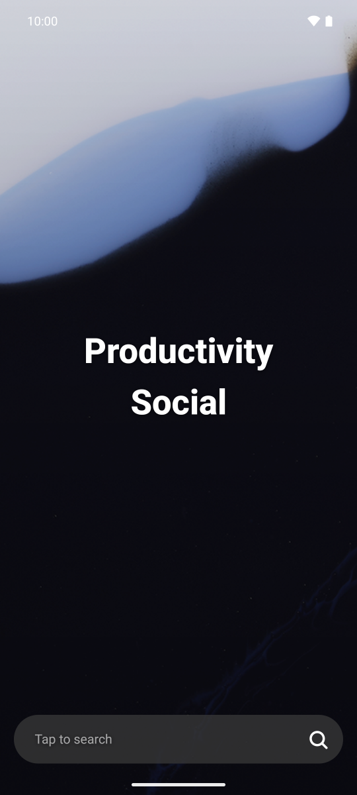
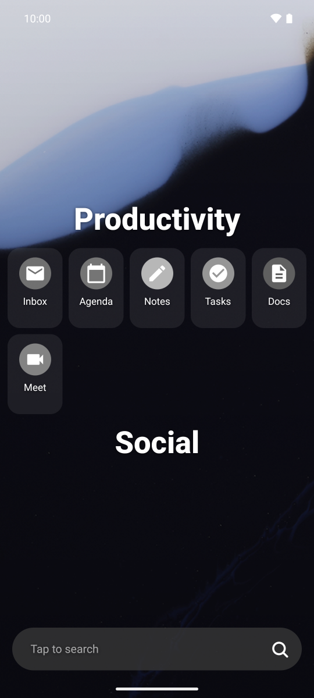
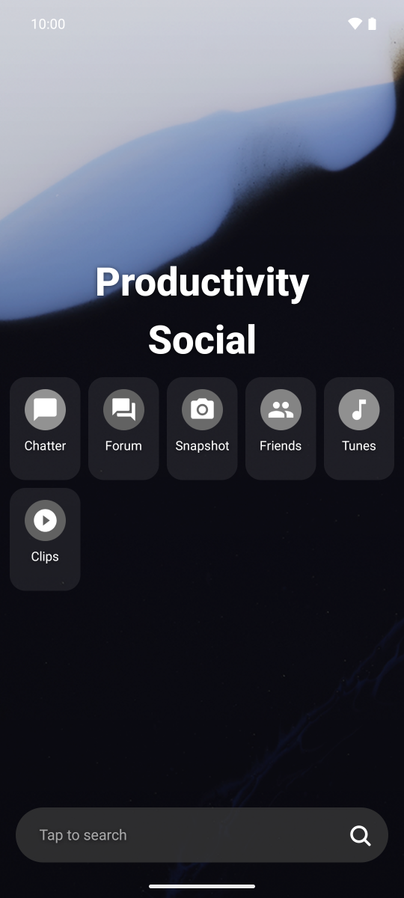
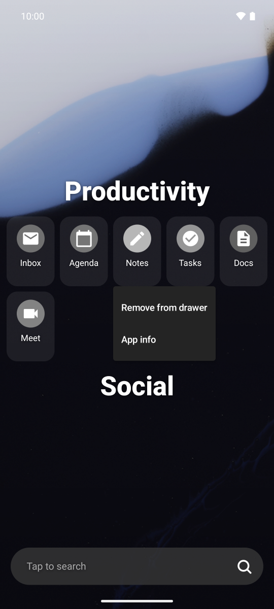
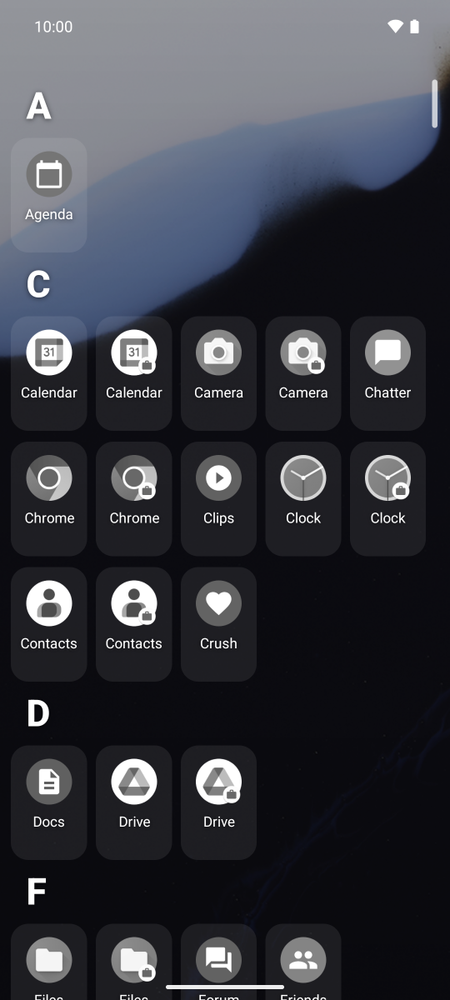
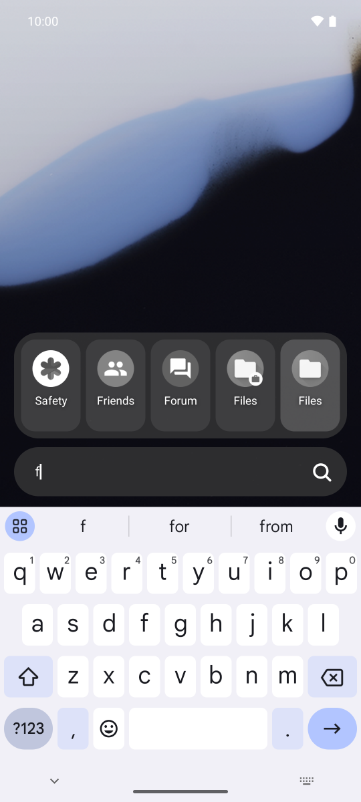
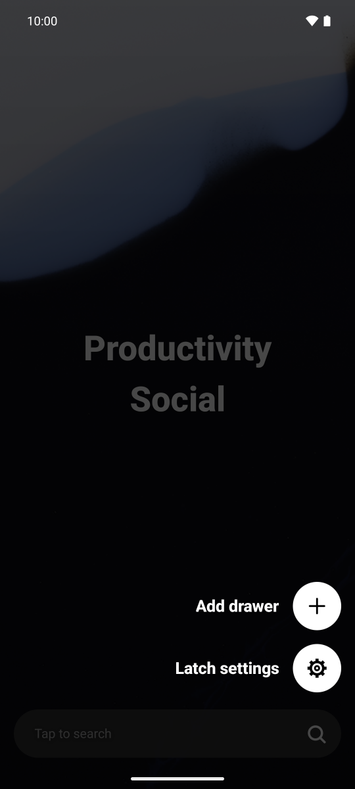
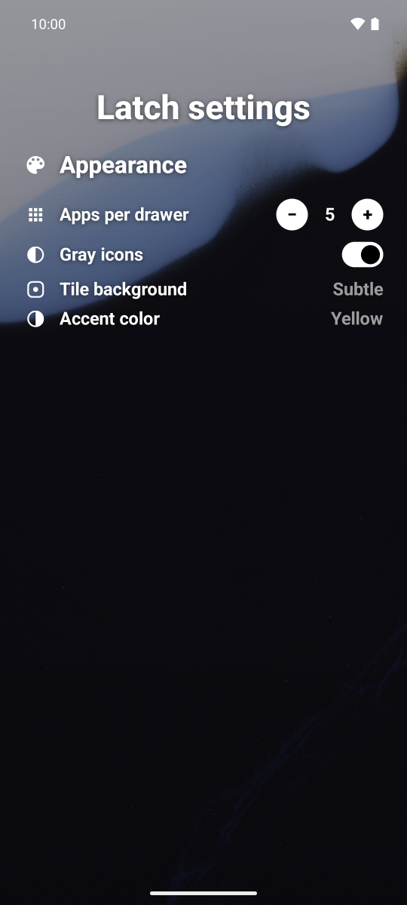

# Latch

[](https://github.com/VDuchauffour/latch/releases/latest)
[](https://github.com/VDuchauffour/latch/actions/workflows/ci.yml)
[](https://github.com/VDuchauffour/latch/actions/workflows/release.yml)
[](https://github.com/VDuchauffour/latch/releases)
[](LICENSE)
[](https://apps.obtainium.imranr.dev/redirect?r=obtainium://app/%7B%22id%22%3A%22app.latch%22%2C%22url%22%3A%22https%3A%2F%2Fgithub.com%2FVDuchauffour%2Flatch%22%2C%22author%22%3A%22VDuchauffour%22%2C%22name%22%3A%22Latch%22%2C%22supportFixedAPKURL%22%3Afalse%7D)

A minimal, text-first Android launcher: a centered list of user-defined **categories** that expand into their apps, plus a swipe-up **A–Z app drawer**. Kotlin + Jetpack Compose, single activity. See [PLAN.md](PLAN.md) for the spec and architecture.

## Screenshots

|                                                                                                  |                                                                                                                     |                                                                                                   |                                                                                    |
| :----------------------------------------------------------------------------------------------: | :-----------------------------------------------------------------------------------------------------------------: | :-----------------------------------------------------------------------------------------------: | :--------------------------------------------------------------------------------: |
|              <br>Home              | <br>Productivity drawer | <br>Social drawer | <br>App menu |
| <br>A–Z app drawer |                    <br>Search                     |     <br>Quick menu      | <br>Settings |

Regenerate them on the emulator with `just screenshots` (placeholder apps from [screenshots/fakeapps](screenshots/fakeapps)).

## Install

Download `latch-vX.Y.Z.apk` from the [latest release](https://github.com/VDuchauffour/latch/releases/latest), or add Latch to [Obtainium](https://apps.obtainium.imranr.dev/redirect?r=obtainium://app/%7B%22id%22%3A%22app.latch%22%2C%22url%22%3A%22https%3A%2F%2Fgithub.com%2FVDuchauffour%2Flatch%22%2C%22author%22%3A%22VDuchauffour%22%2C%22name%22%3A%22Latch%22%2C%22supportFixedAPKURL%22%3Afalse%7D) to get updates automatically (or add `https://github.com/VDuchauffour/latch` as an app in Obtainium by hand).

## Build & run

Requirements: JDK 17, Android SDK with platform 35.

One-time setup (installs JDK 17, the Android SDK, and yq via [mise](https://mise.jdx.dev/), then accepts SDK licenses):

```sh
mise install # or: just setup (also accepts SDK licenses)
```

```sh
./gradlew installDebug
adb shell cmd package set-home-activity app.latch/.MainActivity # make Latch the home app
```

With multiple devices/emulators connected, target one via `adb`'s serial:

```sh
export ANDROID_SERIAL=emulator-5554 # gradle installDebug and connected tests use only this device
```

Release build (R8 + resource shrinking; signed with the debug key unless the `LATCH_KEYSTORE_*` env vars are set):

```sh
./gradlew assembleRelease
```

## Releasing

[release-drafter](.github/release-drafter.yml) keeps a draft release up to date as PRs merge. Publishing it triggers the [Release APK](.github/workflows/release.yml) workflow, which builds the APK with the version from the tag (`v1.2.3` → `versionName` 1.2.3, `versionCode` 10203), signs it with the release key, and attaches `latch-v1.2.3.apk` to the release. Re-run it for an existing tag from the Actions tab.

One-time setup of the release key (stored outside the repo and uploaded as the `LATCH_KEYSTORE_BASE64`, `LATCH_KEYSTORE_PASSWORD`, `LATCH_KEY_ALIAS`, `LATCH_KEY_PASSWORD` repository secrets):

```sh
just release-keystore # defaults to ~/.android/latch-release.jks
```

Back the keystore up: Android (and Obtainium) only install updates signed with the same key, so losing it means every user has to uninstall and reinstall.

## Tests

```sh
./gradlew testDebugUnitTest         # JVM: AlphaSections, CategoryOps, JSON codec
./gradlew connectedDebugAndroidTest # device/emulator: CategoryStore persistence, Compose UI
```

Note: installing the test APK can reset the default home app; run `set-home-activity` again afterwards.

## Using it

- **Tap** a category name to expand/collapse it; **tap** an app to launch it.
- **Swipe up** for the drawer; swipe down at the top, Back, or Home closes it.
- **Long-press** an app for its menu; **long-press and move** to drag it onto a category name (from the drawer = add, from another category = move).
- **Long-press** a category name for Rename / Delete; **long-press and move** it vertically to reorder.
- **Home** while on Home collapses everything and closes the drawer.

## Layout

```
app/src/main/java/app/latch/
 ├─ domain/   pure Kotlin (no android.*): AppKey, Category, AlphaSections, CategoryOps
 ├─ data/     AppRepository (LauncherApps), CategoryStore (DataStore JSON), IconLoader, AppLauncher
 └─ ui/       LatchViewModel, LatchScreen (root, drawer sheet), HomeScreen, AppDrawer, AppTile, DragState
```

## License

[MIT](LICENSE)
